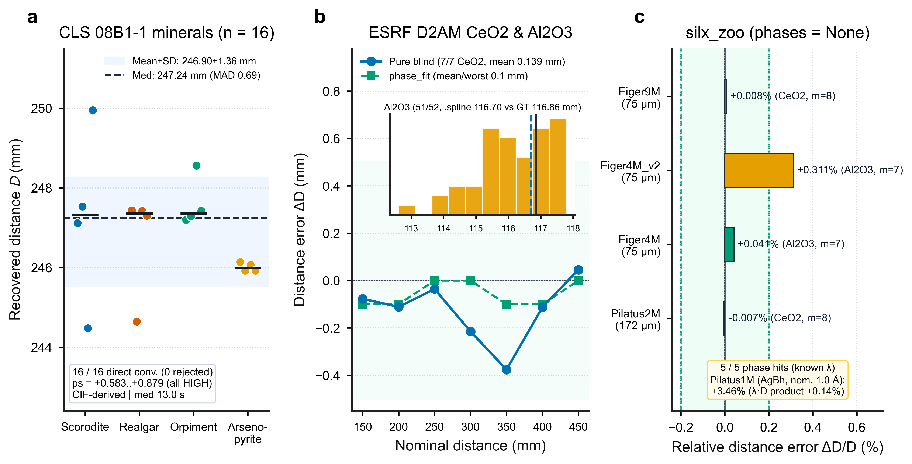

<div align="center">

# pyfai-zero-shot

**Phasenblinde, vorwissenfreie geometrische Kalibrierung von 2D-Pulver-Röntgendetektoren<br>für Vollringe und off-axis Teilbögen**

🚫 Keine Kalibrant-Vorgabe &nbsp;·&nbsp; 🚫 Keine Startgeometrie &nbsp;·&nbsp; 🌍 11-Sprachen-GUI (inkl. RTL Arabisch)<br>✅ Standard-pyFAI-<code>.poni</code>-Export &nbsp;·&nbsp; ✅ Identifizierbarkeitsstufen &nbsp;·&nbsp; ✅ Commit <code>f608e67</code>

[English](README.md) · [简体中文](README.zh-CN.md) · [正體中文](README.zh-TW.md) · **Deutsch** · [Русский](README.ru.md) · [Français](README.fr.md) · [日本語](README.ja.md)

[](LICENSE)
[]()
[]()
[-009E73)]()
[](manuscript/pyFAI-ZeroShot_SciAdv_ResearchResource.pdf)

</div>

---

## Manuskript & Preprint (Science Advances — Research Resource)

- 📄 **Hauptmanuskript PDF (10 S.):** [pyFAI-ZeroShot_SciAdv_ResearchResource.pdf](manuscript/pyFAI-ZeroShot_SciAdv_ResearchResource.pdf) ([Markdown](manuscript/SciAdv_ResearchResource_v1.md))
- 📊 **Supplementary Materials PDF (Tabellen S1–S5):** [pyFAI-ZeroShot_SciAdv_Supplementary.pdf](manuscript/pyFAI-ZeroShot_SciAdv_Supplementary.pdf)
- 🔒 **Eingefrorene Benchmarks (`f608e67`):** [docs/paper_numbers_freeze_2026-11-27_f608e67.md](docs/paper_numbers_freeze_2026-11-27_f608e67.md)

## Desktop-GUI (11 Sprachen)

- **PyFAI-Workflow (`probes/gui_workflow.py`)** — 5-stufige Workflow-Oberfläche mit Auto-Masking, Cake-Diagnose und Live-Umschaltung zwischen **11 Sprachen** (`probes/i18n_wf.py`: zh, en, zh_TW, ja, fr, de, ru, pt, ko, es, ar inkl. RTL).
- **DiffBlindWizard (`probes/gui_wizard.py`)** — geführter 5-Schritte-Assistent.

## Funktionsweise

1. **Vorverarbeitung:** `auto_offset` entfernt negative Flachdetektor-Offsets; `auto_mask` maskiert Modulspalten, Defektpixel und Beamstop-Schatten.
2. **Mehrskalige Canvas-Leiter (`R2`):** Start bei `≤ 520 px`, bedingte Eskalation auf `ceil(maxdim/2)` bei Divergenz (`s ≥ 5`, `|ΔD|/D ≥ 10%`).
3. **Zentrierung & Phasenarbitrierung:** Schärfe-/Kåsa-Guard, Radialsymmetrie + Strahl-Seeds, Konsenswahl und Pearson-Profilscore `ps`.
4. **Feinjustierung:** Native 2D-Taubin-Kreisanpassung für Vollringe; regularisierte `1440²`-Ecken-Kippung + **2-Parameter-Differential-Pseudo-Voigt-Entkopplung** (`r_i = D tan(2θ_i) + δr_0`) für Teilbögen (`az_cov < 50%`).

<div align="center">

</div>

## Verifizierte Benchmarks (`f608e67`, Kaltstart)

| Benchmark | Ergebnis (`f608e67`) |
| :--- | :--- |
| **DESY PETRA III P02.1** (13 Scans, 230–2290 mm) | **13/13 (100%)** `LaB6`, **13/13 `< 0.12%`**, Median **`0.030%`** (Locked OOD `0.028%`), R² `0.999999`, RMSE `0.82 mm`, Ecken-ΔC **`0.74 px`** (`9.7×`) |
| **CLS 08B1-1 Minerale** (16 Frames, 4 Arsenminerale) | **16/16 (100%)** direkte Konvergenz, **`246.90 ± 1.36 mm`**, MAD **`0.69 mm`** |
| **ESRF D2AM `MX_ceria` & `Al2O3`** | `CeO2` blind **7/7** (`0.139 mm` Mittel) / `phase_fit` **`0.1 mm`**; `Al2O3` **51/52**, `.spline` **`116.70 mm`** vs. GT `116.86 mm` |
| **`silx_zoo` Detektor-Transfer** | **5/5** Phasentreffer (`Pilatus2M −0.007%`, `Eiger4M +0.041%`, `Eiger9M +0.008%`) |
| **100 synthetische Fälle** (`Seed = 20261120`) | Scharfe Grenze bei `n_vis ≥ 4`: **41/41 `≤ 1.0%`**, **40/41 `≤ 0.20%`**, Median **`0.0010%`** vs. `n_vis ≤ 3` (`27.1%`) |
| **Vergleich mit `pyFAI`** (24 reale Frames) | `pyFAI` Zero-Init **3/24 (12.5%)** → `Ours` **24/24 (100%)** (`0.033%`) → Seeded `pyFAI` **24/24 (100%)** (**`0.006%` / `0.11 px`**) |

<details>
<summary><b>Weitere Abbildungen aus dem Manuskript</b></summary>

<div align="center">
<br><br>
<br><br>
<br><br>

</div>

</details>

## Schnellstart

```bash
pip install numpy scipy matplotlib pyFAI fabio pillow h5py PyQt5
```

```python
import fabio, numpy as np
from probes.solver_core import auto_offset, solve_image
from probes.auto_mask import build_auto_mask

img = auto_offset(fabio.open("your_frame.tif").data.astype(np.float64))
mask, _ = build_auto_mask(img)
res = solve_image(img, px_m=150e-6, lam=0.20735, phases=None, mask=mask)
print(res["phase"], res["sol"], res["confidence"]["tier"])
```

```bash
# Launch the 11-language desktop workflow GUI (zh/en/zh_TW/ja/fr/de/ru/pt/ko/es/ar)
python probes/gui_workflow.py
# Or launch the 5-step beginner wizard
python probes/gui_wizard.py
```

## Zitation

```bibtex
@article{liu2026pyfaizeroshot,
  author  = {Liu, Zi'ao and Liu, Jiaru and Liu, Haixia},
  title   = {Phase-blind, zero-prior geometric calibration of two-dimensional powder X-ray diffraction detectors across full rings and off-axis partial arcs},
  year    = {2026},
  note    = {Science Advances Research Resource manuscript; frozen release commit f608e67},
  url     = {https://github.com/ziaoliu902-cyber/pyfai-zero-shot}
}
```

## Lizenz & Danksagung

We acknowledge DESY (Hamburg, Germany), a member of the Helmholtz Association HGF, for the provision of experimental facilities. Parts of this research were carried out at PETRA III beamline P02.1. Beamtime was allocated by an In-House contingent. We thank Dr. Martin Etter and the PETRA III P02.1 beamline team for acquiring and providing the NIST SRM 660c LaB6 flat-panel calibration datasets.

<sub>MIT-Lizenz ([LICENSE](LICENSE)). Synchronisiert mit Commit `f608e67`.</sub>
