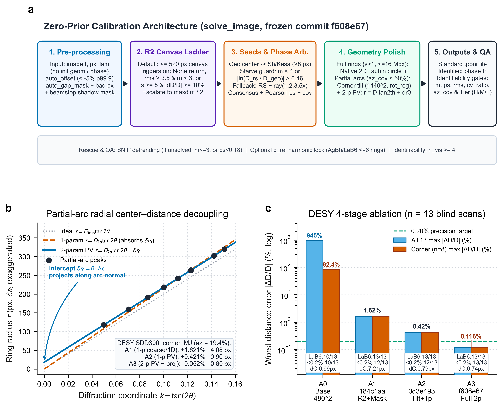
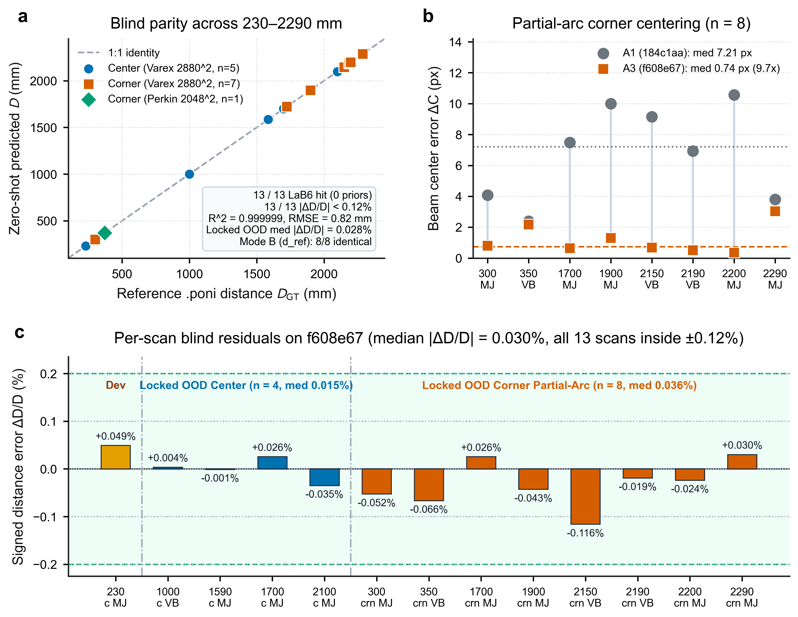

<div align="center">

# pyfai-zero-shot

**既知相・初期ジオメトリ不要の2次元粉末X線回折検出器自動キャリブレーションツール<br>完全リング・コーナー部分弧対応 · pyFAI .poni 直接出力**

🚫 標準試料の指定不要 &nbsp;·&nbsp; 🚫 初期距離・中心推定不要 &nbsp;·&nbsp; 🌍 11言語GUI（アラビア語RTL対応）<br>✅ pyFAI <code>.poni</code> 出力 &nbsp;·&nbsp; ✅ Cake品質診断 &nbsp;·&nbsp; ✅ カスタム CIF 対応

[English](README.md) · [简体中文](README.zh-CN.md) · [正體中文](README.zh-TW.md) · [Deutsch](README.de.md) · [Русский](README.ru.md) · [Français](README.fr.md) · **日本語**

[](LICENSE)
[]()
[]()
[-009E73)]()

</div>

---

## pyfai-zero-shot とは？

`pyFAI-calib2` や `DIOPTAS` は初期値が近ければサブピクセル精度に達しますが、初期距離が不明な場合や検出器コーナーにビームがある場合は局所解に陥りやすくなります。

`pyfai-zero-shot` は画像配列・ピクセルサイズ・波長のみから相同定とジオメトリ推定を自動実行し、そのまま使える `.poni` を出力します。

## 11言語デスクトップGUI

- **PyFAI-Workflow (`probes/gui_workflow.py`)** — 5段階フローチャートUI。**`probes/i18n_wf.py` により11言語を即時切替**（zh, en, zh_TW, ja, fr, de, ru, pt, ko, es, ar RTL対応）。
- **DiffBlindWizard (`probes/gui_wizard.py`)** — 5ステップの対話型ウィザード。
- **カスタム相 (`probes/custom_phase.py`)** — 任意の `.cif` / `.D` ファイルを読み込み可能。

## 動作原理

1. **前処理：** `auto_offset` と `auto_mask` により負ペデスタル・ギャップ・不良画素・ビームストップ影を自動除去。
2. **マルチスケール階梯 (`R2`)：** `≤ 520 px` から開始し、分岐検出時に `ceil(maxdim/2)` へ自動昇格。
3. **中心・相同定：** シャープネス/Kåsaガード、放射対称+レイ外挿シード、コンセンサス投票とプロファイル相関 `ps`。
4. **精密化：** 完全リングは2D Taubin円フィット、部分弧は正則化 `1440²` チルト＋**2パラメータ差分Pseudo-Voigt分離**。

<div align="center">

</div>

## ベンチマーク精度（コールドスタート・初期値なし）

| ベンチマーク | 実測精度 |
| :--- | :--- |
| **DESY PETRA III P02.1**（13スキャン, 230–2290 mm） | **13/13 (100%)** `LaB6`, **13/13 `< 0.12%`**, 中央値 **`0.030%`**, R² `0.999999`, コーナーΔC **`0.74 px`** |
| **CLS 08B1-1 鉱物**（16フレーム, 4鉱物） | **16/16 (100%)** 収束, **`246.90 ± 1.36 mm`**, MAD **`0.69 mm`** |
| **ESRF D2AM `MX_ceria` & `Al2O3`** | `CeO2` 盲解 **7/7**（平均 `0.139 mm`）；`Al2O3` **51/52**, `.spline` **`116.70 mm`** vs GT `116.86 mm` |
| **異検出器 `silx_zoo`** | **5/5** 相同定（`Pilatus2M −0.007%`, `Eiger4M +0.041%`, `Eiger9M +0.008%`） |
| **100例合成境界** | **4環以上**: **41/41 `≤ 1.0%`**, **40/41 `≤ 0.20%`**, 中央値 **`0.0010%`**（3環以下: `27.1%`） |
| **標準 `pyFAI` 比較**（24実フレーム） | 初期値なし `pyFAI` **3/24 (12.5%)** → 本ツール **24/24 (100%)** (`0.033%`) → 本ツール初期値で `pyFAI` **24/24 (`0.006%` / `0.11 px`)** |

<details>
<summary><b>詳細な検証グラフを表示</b></summary>

<div align="center">
<br><br>
<br><br>
<br><br>

</div>

</details>

## クイックスタート

```bash
pip install numpy scipy matplotlib pyFAI fabio pillow h5py PyQt5
```

```python
import fabio, numpy as np
from probes.solver_core import auto_offset, solve_image
from probes.auto_mask import build_auto_mask
from probes.cake_report import export_poni_from_result

# Load any 2-D powder diffraction image (TIFF / EDF / CBF / HDF5)
img = auto_offset(fabio.open("your_frame.tif").data.astype(np.float64))
mask, _ = build_auto_mask(img)

# Zero-prior solve: provide only pixel pitch (m) and wavelength (Å)
res = solve_image(img, px_m=150e-6, lam=0.20735, phases=None, mask=mask)
print(f"Phase: {res['phase']}, m={res['m']}, ps={res['ps']:.3f}, tier={res['confidence']['tier']}")
```

```bash
# 11-language visual workflow workbench (zh/en/zh_TW/ja/fr/de/ru/pt/ko/es/ar incl. RTL)
python probes/gui_workflow.py

# 5-step guided calibration wizard for beginners
python probes/gui_wizard.py
```

## 引用

```bibtex
@software{pyfai_zero_shot_2026,
  author  = {Liu, Zi'ao and Liu, Jiaru and Liu, Haixia},
  title   = {pyfai-zero-shot: phase-blind, zero-prior geometry calibration of 2-D X-ray powder diffraction detectors},
  year    = {2026},
  url     = {https://github.com/ziaoliu902-cyber/pyfai-zero-shot},
  license = {MIT}
}
```

## ライセンスと謝辞

We acknowledge DESY (Hamburg, Germany), a member of the Helmholtz Association HGF, for the provision of experimental facilities. Parts of this research were carried out at PETRA III beamline P02.1. Beamtime was allocated by an In-House contingent. We thank Dr. Martin Etter and the PETRA III P02.1 beamline team for providing the NIST SRM 660c LaB6 flat-panel calibration datasets used in our benchmark validation, as well as the pyFAI community, ESRF D2AM (BM02), and CLS 08B1-1 for open diffraction datasets.

<sub>MITライセンス（[LICENSE](LICENSE)）。</sub>
