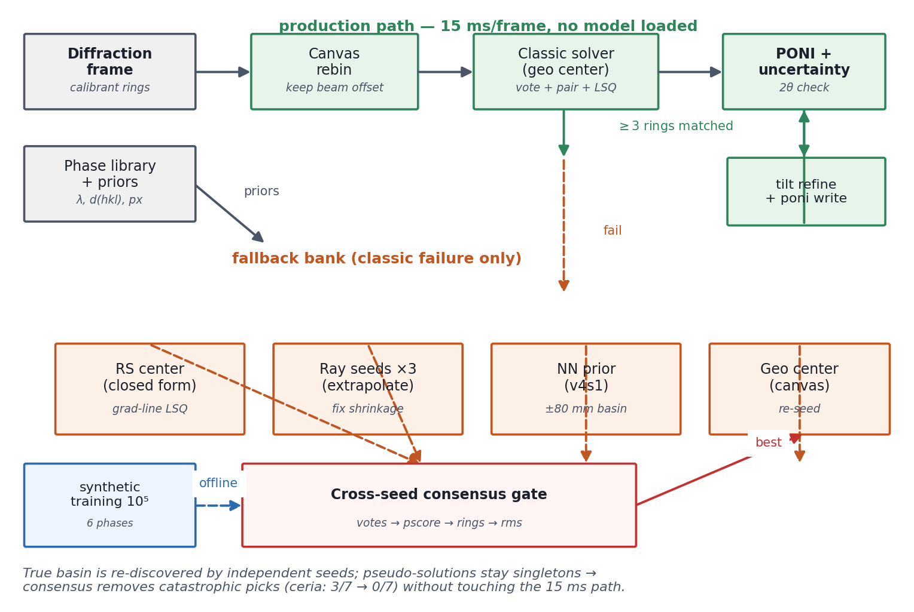
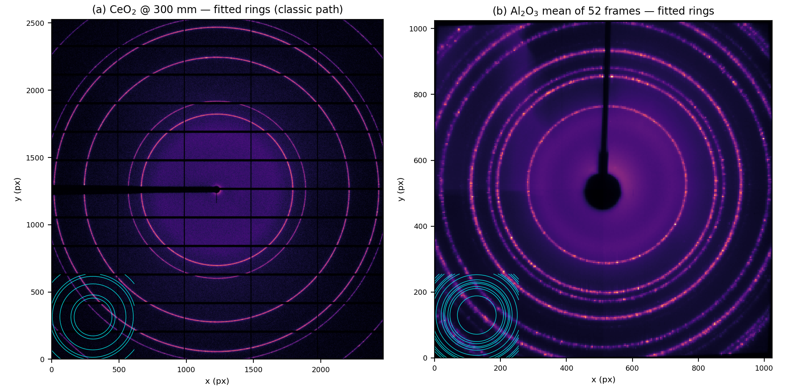
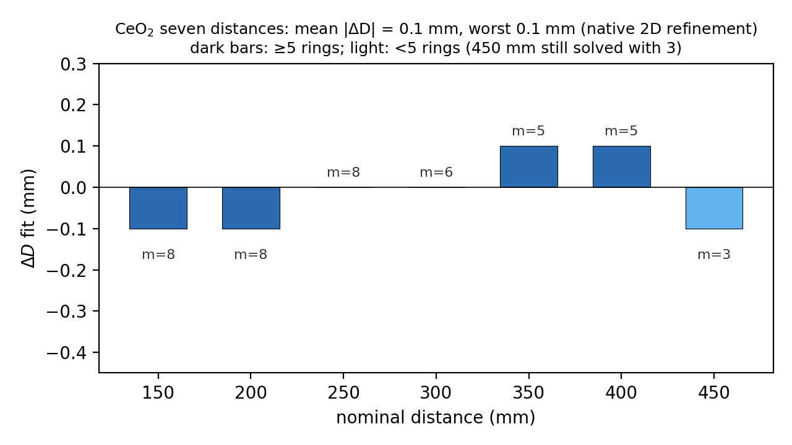
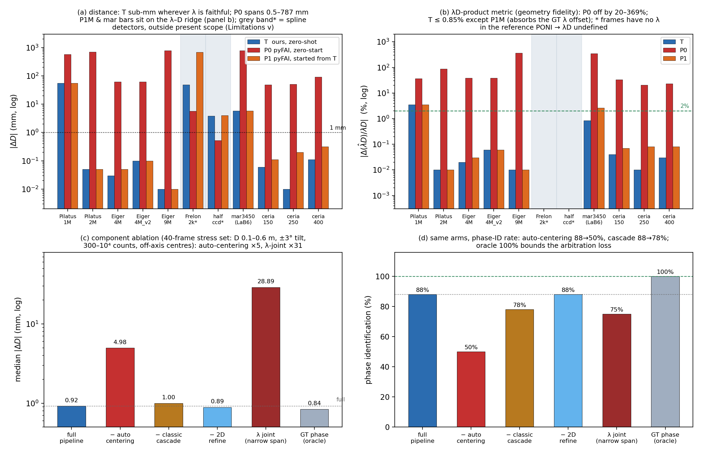

<div align="center">

# pyfai-zero-shot

**Phase-blind, zero-shot geometry calibration of 2-D X-ray detectors<br>from a single powder-ring frame**

🚫 no calibrant identity &nbsp;·&nbsp; 🚫 no initial geometry &nbsp;·&nbsp; 🚫 optionally no wavelength<br>
✅ standard pyFAI PONI out &nbsp;·&nbsp; ✅ bootstrap uncertainties

**English** · [简体中文](README.zh-CN.md) · [正體中文](README.zh-TW.md) · [Deutsch](README.de.md) · [Русский](README.ru.md) · [Français](README.fr.md) · [日本語](README.ja.md)

[](LICENSE)
[]()
[]()
[]()
[]()

</div>


## Downloads

No Python needed — Windows portable builds on the [v0.9.0 release](https://github.com/ziaoliu902-cyber/pyfai-zero-shot/releases/tag/v0.9.0):

- 🧙 **DiffBlindWizard** — 5-step wizard for beginners (pick image → confirm → solve → verdict light → export PONI)
- 🛠 **PyFAI-Blind** — expert window (batch mode, 🔗 joint calibration, 🏠 weak-diffraction mean-frame seed, drift curves)

Both accept --selftest for a headless integrity check.

---

## Why

Standard calibration tools (pyFAI `calib2`, DAWN, FIT2D) presume a **known
calibrant, manual ring picking and a good initial guess**. Run from a cold
start they lock onto self-consistent but *wrong* solutions — the
ring-index/distance degeneracy — with a small residual that hides the
error. On the public benchmark below, zero-start pyFAI fails **11/11**
frames; this pipeline solves most of them unattended, from a single frame,
without being told what the sample is.

## How it works

A **classic-first cascade** over a powder-phase library, arbitrated by a
**cross-seed consensus gate**:

1. a fast peak-position solver runs first from the canvas centre
   (15 ms/frame);
2. only on failure, fallback seeds engage — a closed-form radial-symmetry
   centre estimator, ray extrapolations compensating its off-axis bias,
   and optionally a regression neural network;
3. seeds vote; the solution that independent seeds re-discover wins,
   eliminating pseudo-solutions;
4. tilt refinement + bootstrap photon resampling → a standard **PONI**
   with per-quantity uncertainties.

<div align="center">

</div>

## Results at a glance

| Benchmark | Result |
|---|---|
| CeO₂ calibrant · 7 distances, 150–450 mm | mean & worst \|ΔD\| = **0.1 mm**, 7/7 converge; classic path 15 ms/frame |
| Al₂O₃ · 52 static frames | 51/52 solved (one dark frame correctly rejected); scatter **MAD 0.45 mm**; bootstrap σ(D) = **0.47 mm**, ground-truth coverage 6/6 |
| Cross-instrument · 10 public images (8 evaluable) | phase identified **6/8**; \|ΔD\| ≤ 0.1 mm on **4/8**; tilt ≲ 5 mrad; *every failure attributed* |
| Weak diffraction (Al₂O₃, deep averaging) · v0.9 | 51-frame mean seed → joint solve: seed \|ΔD\| **0.13 mm**, per-frame MAD **0.08 mm**, σ_boot(D) **0.019 mm**, ~2 min |
| Independent check | cold-start pyFAI fails **11/11** of the same frames; started from our solution it matches us — the gain is initialization, not a different engine |

<div align="center">
<br>
<sub>Benchmark frames with fitted rings: (a) CeO₂ at 300 mm (8 matched rings); (b) mean of the 52 static Al₂O₃ frames.</sub>
</div>

<details>
<summary><b>More evidence</b> (CeO₂ distance errors · independent pyFAI duel)</summary>

<div align="center">
<br>
<sub>CeO₂ seven-distance errors, native 2-D refinement: mean and worst |ΔD| = 0.1 mm.</sub><br><br>
<br>
<sub>Independent comparison with pyFAI (zero-start P0 vs. this pipeline T, same-start P1) and component ablation.</sub>
</div>

</details>

## Quick start

```bash
pip install numpy scipy matplotlib pyFAI fabio pillow h5py torch
```

```python
import fabio
from probes.solver_core import solve_image

img = fabio.open("your_frame.edf").data.astype(float)
img[img >= 1e9] = 0.0            # sentinel / negative masking (zoo scope)
img[img < 0] = 0.0

res = solve_image(img, px_m=172e-6)      # lam=None → joint λ–D mode
print(res["phase"], res["sol"])          # phase id + geometry solution
```

Download the public test images referenced in the paper
(<https://www.silx.org/pub/pyFAI/testimages/>) into `data/real/`, then run
the probes — every table in `probes/results/` is regenerated
deterministically (fixed seeds).

| Entry point | Purpose |
|---|---|
| `probes/solver_core.py` | unified `solve_image()` (canvas + zero-shot-safe fallback) |
| `probes/zoo_run.py` | cross-instrument benchmark (silx test images) |
| `probes/phase_map.py` | condition map (exposure / tilt / span) |
| `probes/ablation8.py` | component ablation (stress set) |
| `probes/_pyfai_duel.py` | independent comparison with pyFAI |
| `generators/train.py` | NN initializer training (synthetic frames) |

## Repository layout

```
torchfai/      solver library (phases, simulator, refine, model)
probes/        benchmark probes, figure scripts, GUI solver
  results/     full result tables (.md/.json/.txt) + reference PONIs
generators/    NN-training data generators + merge tools
docs/          technical evidence documents (experiment logs)
manuscript/    paper draft v0.5 (Markdown)
assets/        figures used in this README
```

## Blind-test invitation

> We are collecting **1–2 historical frames + their reference .poni** from
> any beamline — any detector, calibrant, distance, wavelength, vintage.
> You send the image and the known calibration; we run it fully blind and
> return ΔD, beam centre, tilt, a ready-to-use PONI, uncertainty intervals
> and the phase identification. We never see the reference until our
> solution is fixed and time-stamped. **Negative results are reported as
> such** — failures come with attribution, not excuses.

**Contact:** Ziao Liu · ziaoliu902@gmail.com

## Citation

```bibtex
@software{pyfai_zero_shot_2026,
  author = {Liu, Ziao},
  title  = {pyfai-zero-shot: phase-blind, zero-shot geometry calibration
            of 2-D X-ray detectors from powder rings},
  year   = {2026},
  url    = {https://github.com/ziaoliu902-cyber/pyfai-zero-shot},
  note   = {v0.5}
}
```

## License & acknowledgments

MIT (see [LICENSE](LICENSE)). The benchmark frames are the publicly
distributed pyFAI test images (silx.org, acquired at D2AM/BM02, ESRF);
this project is an independent user of pyFAI and is not affiliated with
the pyFAI team.

<sub>The manuscript (v0.5) is a draft in preparation and has not been
peer reviewed. Multilingual READMEs are maintained manually; the English
version is authoritative.</sub>
