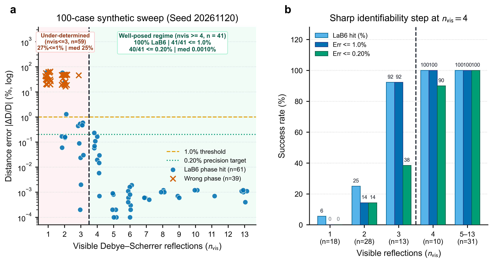

<div align="center">

# pyfai-zero-shot

**無須先驗物相與初始幾何的二維粉晶 X 射線探測器自動標定引擎<br>全環與離軸四角殘弧通用 · 11 語種桌面工作台**

🚫 無須指定標樣物相 &nbsp;·&nbsp; 🚫 無須初始距離/束心 &nbsp;·&nbsp; 🌍 11 語言桌面端（含阿拉伯語 RTL）<br>✅ 直接匯出標準 pyFAI <code>.poni</code> &nbsp;·&nbsp; ✅ 定量可辨識度分級 &nbsp;·&nbsp; ✅ 凍結基線 <code>f608e67</code>

[English](README.md) · [简体中文](README.zh-CN.md) · **正體中文** · [Deutsch](README.de.md) · [Русский](README.ru.md) · [Français](README.fr.md) · [日本語](README.ja.md)

[](LICENSE)
[]()
[]()
[-009E73)]()
[](manuscript/pyFAI-ZeroShot_SciAdv_ResearchResource.pdf)

</div>

---

## 論文預印本（Science Advances — Research Resource 格式）

- 📄 **英文正文 PDF（10 頁）**：[pyFAI-ZeroShot_SciAdv_ResearchResource.pdf](manuscript/pyFAI-ZeroShot_SciAdv_ResearchResource.pdf)（[Markdown](manuscript/SciAdv_ResearchResource_v1.md)）
- 📊 **補充材料 PDF（Tables S1–S5）**：[pyFAI-ZeroShot_SciAdv_Supplementary.pdf](manuscript/pyFAI-ZeroShot_SciAdv_Supplementary.pdf)（[Markdown](manuscript/SciAdv_Supplementary_v1.md)）
- 🔒 **全量凍結基準表（`f608e67`）**：[docs/paper_numbers_freeze_2026-11-27_f608e67.md](docs/paper_numbers_freeze_2026-11-27_f608e67.md)

## 多語言桌面工作台（11 種語言）

- **PyFAI-Workflow (`probes/gui_workflow.py`)** — 5 階段視覺化流程圖工作台，整合自動遮罩、Cake 展開體檢與置信度分級，內建 **`probes/i18n_wf.py` 11 語種即時切換**（简体中文、English、正體中文、日本語、Français、Deutsch、Русский、Português、한국어、Español、العربية 含原生 RTL 版面）。
- **DiffBlindWizard (`probes/gui_wizard.py`)** — 5 步驟引導式 `.poni` 生成精靈。

## 核心原理

1. **自適應前處理**：`auto_offset` 扣除平板探測器負基底；`auto_mask` 自動遮罩模組縫隙、壞點熱像素與束流擋片陰影。
2. **多尺度畫布階梯（`R2`）**：預設 `≤ 520 px`，遇分叉風險（`s ≥ 5` 且 `|ΔD|/D ≥ 10%`）自動升級至 `ceil(maxdim/2)`。
3. **零先驗定心與物相仲裁**：Layer-0 銳度/Kåsa 守衛、環飢餓守衛、徑向對稱+射線多種子共識投票與 Pearson 譜相關 `ps`。
4. **全環與部分弧精修**：全環採用原生 2D Taubin 圓擬合；離軸四角殘弧（`az_cov < 50%`）啟用 `1440²` 正則化傾角與**兩參數差分 Pseudo-Voigt 解耦**。

<div align="center">

</div>

## 凍結基線實測結果（`f608e67`）

| 基準測試集 | 實測表現（`f608e67` 冷啟動） |
| :--- | :--- |
| **DESY PETRA III P02.1 盲測**（13 組，230–2290 mm） | **13/13 (100%)** `LaB6`，**13/13 `< 0.12%`**，中位 **`0.030%`**（Locked OOD `0.028%`），R² `0.999999`，RMSE `0.82 mm`，角束定心 **`0.74 px`**（提升 `9.7×`） |
| **CLS 08B1-1 真實礦物**（16 幀，4 種含砷礦物） | **16/16 (100%)** 直接收斂，**`246.90 ± 1.36 mm`**，MAD **`0.69 mm`**，`ps = +0.583..+0.879` |
| **ESRF D2AM `MX_ceria` & `Al2O3`** | `CeO2` 純盲解 **7/7**（均差 `0.139 mm`）/ `phase_fit` **`0.1 mm`**；`Al2O3` **51/52**，`.spline` **`116.70 mm`** vs GT `116.86 mm` |
| **跨探測器 `silx_zoo`**（已知 λ） | **5/5** 物相全中（`Pilatus2M −0.007%`、`Eiger4M +0.041%`、`Eiger9M +0.008%`） |
| **100 例合成可辨識性邊界** | `n_vis ≥ 4`：**41/41 (100%) `≤ 1.0%`**，**40/41 `≤ 0.20%`**，中位 **`0.0010%`**；`n_vis ≤ 3` 僅 `27.1%` |
| **與無加權 `pyFAI` 24 幀對比** | 零初值 `pyFAI` **3/24 (12.5%)** → 本引擎 **24/24 (100%)**（`0.033%`）→ 驅動 `pyFAI` **24/24 (100%)**（**`0.006%` / `0.11 px`**） |

<details>
<summary><b>更多論文主圖（DESY 盲測 · 可辨識性 · 跨光源 · pyFAI 對比）</b></summary>

<div align="center">
<br><br>
<br><br>
<br><br>

</div>

</details>

## 快速開始

```bash
pip install numpy scipy matplotlib pyFAI fabio pillow h5py PyQt5
```

```python
import fabio, numpy as np
from probes.solver_core import auto_offset, solve_image
from probes.auto_mask import build_auto_mask

img = auto_offset(fabio.open("your_frame.tif").data.astype(np.float64))
mask, _ = build_auto_mask(img)
res = solve_image(img, px_m=150e-6, lam=0.20735, phases=None, mask=mask)
print(res["phase"], res["sol"], res["confidence"]["tier"])
```

```bash
# Launch the 11-language desktop workflow GUI (zh/en/zh_TW/ja/fr/de/ru/pt/ko/es/ar)
python probes/gui_workflow.py
# Or launch the 5-step beginner wizard
python probes/gui_wizard.py
```

## 引用方式

```bibtex
@article{liu2026pyfaizeroshot,
  author  = {Liu, Zi'ao and Liu, Jiaru and Liu, Haixia},
  title   = {Phase-blind, zero-prior geometric calibration of two-dimensional powder X-ray diffraction detectors across full rings and off-axis partial arcs},
  year    = {2026},
  note    = {Science Advances Research Resource manuscript; frozen release commit f608e67},
  url     = {https://github.com/ziaoliu902-cyber/pyfai-zero-shot}
}
```

## 授權與致謝

We acknowledge DESY (Hamburg, Germany), a member of the Helmholtz Association HGF, for the provision of experimental facilities. Parts of this research were carried out at PETRA III beamline P02.1. Beamtime was allocated by an In-House contingent. We thank Dr. Martin Etter and the PETRA III P02.1 beamline team for acquiring and providing the NIST SRM 660c LaB6 flat-panel calibration datasets.

<sub>MIT License（見 [LICENSE](LICENSE)）。多語言 README 已同步至 `f608e67`。</sub>
