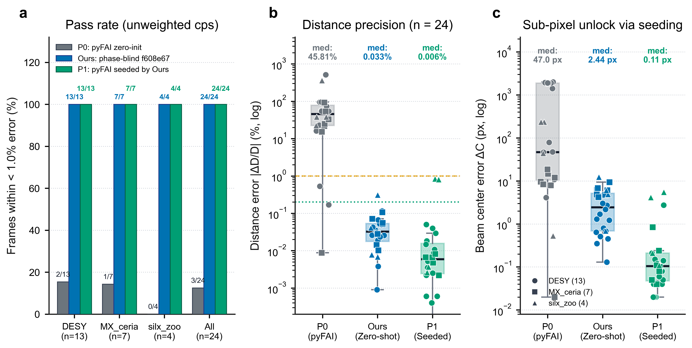

<div align="center">

# pyfai-zero-shot

**無須先驗物相與初始幾何的二維粉晶 X 射線探測器自動標定工具<br>全環與離軸四角殘弧通用 · 直接匯出標準 pyFAI <code>.poni</code>**

🚫 無須指定標樣名稱 &nbsp;·&nbsp; 🚫 無須初始距離/束心 &nbsp;·&nbsp; 🌍 11 語言桌面介面（含阿拉伯語 RTL）<br>✅ 匯出標準 pyFAI <code>.poni</code> &nbsp;·&nbsp; ✅ 內建 Cake 展開體檢與置信度分級 &nbsp;·&nbsp; ✅ 支援自訂 <code>.cif</code> 物相

[English](README.md) · [简体中文](README.zh-CN.md) · **正體中文** · [Deutsch](README.de.md) · [Русский](README.ru.md) · [Français](README.fr.md) · [日本語](README.ja.md)

[](LICENSE)
[]()
[]()
[-009E73)]()

</div>

---

## 為什麼使用 pyfai-zero-shot？

`pyFAI-calib2`、`DIOPTAS` 等軟體在初值準確時精度極高，但若缺少初始距離與束心、或束斑落在探測器角落時，自動配對容易陷入錯位盆地。

`pyfai-zero-shot` 僅需單張繞射圖、像素尺寸與波長即可全自動識別物相並求解幾何，直接匯出 `.poni`（或交由 `pyFAI` 接續亞像素精修）。

## 11 語言桌面工作台與精靈

- **PyFAI-Workflow (`probes/gui_workflow.py`)** — 5 階段視覺化流程圖工作台，內建 **`probes/i18n_wf.py` 11 語種即時切換**（简体中文、English、正體中文、日本語、Français、Deutsch、Русский、Português、한국어、Español、العربية 含原生 RTL）。
- **DiffBlindWizard (`probes/gui_wizard.py`)** — 5 步驟引導式標定精靈。
- **自訂物相 (`probes/custom_phase.py`)** — 支援直接匯入任意 `.cif` 或 `.D` 晶體資料。

## 運作原理

1. **自適應前處理**：`auto_offset` 扣除負基底；`auto_mask` 自動遮罩模組縫隙、壞點與束擋陰影。
2. **多尺度畫布階梯 (`R2`)**：從 `≤ 520 px` 起跑，遇分叉風險自動升級至 `ceil(maxdim/2)`。
3. **零先驗定心與物相仲裁**：銳度/Kåsa 守衛、徑向對稱+射線多種子共識投票與 Pearson 譜相關 `ps`。
4. **全環與部分弧精修**：全環走 2D Taubin 圓擬合；離軸殘弧啟用 `1440²` 正則化傾角與兩參數差分 Pseudo-Voigt 解耦。

<div align="center">

</div>

## 實測精度表現（冷啟動、無幾何先驗）

| 測試集 | 實測結果 |
| :--- | :--- |
| **DESY PETRA III P02.1**（13 組，230–2290 mm） | **13/13 (100%)** `LaB6`，**13/13 `< 0.12%`**，中位 **`0.030%`**，R² `0.999999`，角束定心 **`0.74 px`** |
| **CLS 08B1-1 真實礦物**（16 幀，4 種含砷礦物） | **16/16 (100%)** 收斂，**`246.90 ± 1.36 mm`**，MAD **`0.69 mm`** |
| **ESRF D2AM `MX_ceria` & `Al2O3`** | `CeO2` 盲解 **7/7**（均差 `0.139 mm`）；`Al2O3` **51/52**，`.spline` **`116.70 mm`** vs 真值 `116.86 mm` |
| **跨探測器 `silx_zoo`** | **5/5** 物相命中（`Pilatus2M −0.007%`、`Eiger4M +0.041%`、`Eiger9M +0.008%`） |
| **100 例合成掃參邊界** | 可見環 **≥ 4 條**：**41/41 (100%) `≤ 1.0%`**，**40/41 `≤ 0.20%`**，中位 **`0.0010%`**；`≤ 3` 環僅 `27.1%` |
| **與無加權 `pyFAI` 24 幀對比** | 零初值 `pyFAI` **3/24 (12.5%)** → 本工具 **24/24 (100%)**（`0.033%`）→ 接續 `pyFAI` 達 **`0.006%` / `0.11 px`** |

<details>
<summary><b>展開更多測試圖表</b></summary>

<div align="center">
<br><br>
<br><br>
<br><br>

</div>

</details>

## 快速開始

```bash
pip install numpy scipy matplotlib pyFAI fabio pillow h5py PyQt5
```

```python
import fabio, numpy as np
from probes.solver_core import auto_offset, solve_image
from probes.auto_mask import build_auto_mask
from probes.cake_report import export_poni_from_result

# Load any 2-D powder diffraction image (TIFF / EDF / CBF / HDF5)
img = auto_offset(fabio.open("your_frame.tif").data.astype(np.float64))
mask, _ = build_auto_mask(img)

# Zero-prior solve: provide only pixel pitch (m) and wavelength (Å)
res = solve_image(img, px_m=150e-6, lam=0.20735, phases=None, mask=mask)
print(f"Phase: {res['phase']}, m={res['m']}, ps={res['ps']:.3f}, tier={res['confidence']['tier']}")
```

```bash
# 11-language visual workflow workbench (zh/en/zh_TW/ja/fr/de/ru/pt/ko/es/ar incl. RTL)
python probes/gui_workflow.py

# 5-step guided calibration wizard for beginners
python probes/gui_wizard.py
```

## 引用本軟體

```bibtex
@software{pyfai_zero_shot_2026,
  author  = {Liu, Zi'ao and Liu, Jiaru and Liu, Haixia},
  title   = {pyfai-zero-shot: phase-blind, zero-prior geometry calibration of 2-D X-ray powder diffraction detectors},
  year    = {2026},
  url     = {https://github.com/ziaoliu902-cyber/pyfai-zero-shot},
  license = {MIT}
}
```

## 授權與致謝

We acknowledge DESY (Hamburg, Germany), a member of the Helmholtz Association HGF, for the provision of experimental facilities. Parts of this research were carried out at PETRA III beamline P02.1. Beamtime was allocated by an In-House contingent. We thank Dr. Martin Etter and the PETRA III P02.1 beamline team for providing the NIST SRM 660c LaB6 flat-panel calibration datasets used in our benchmark validation, as well as the pyFAI community, ESRF D2AM (BM02), and CLS 08B1-1 for open diffraction datasets.

<sub>MIT License（見 [LICENSE](LICENSE)）。</sub>
